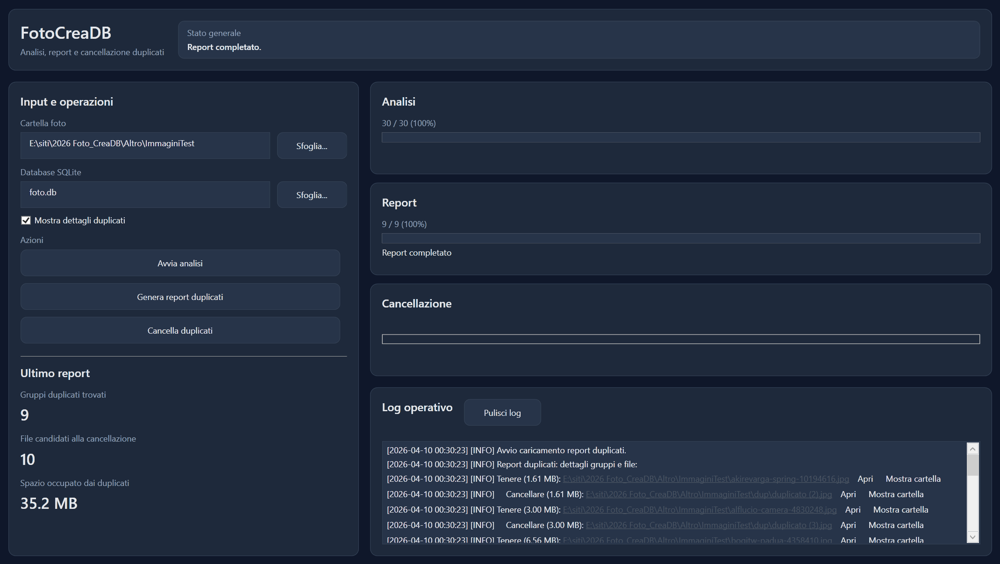

# FotoCreaDB



App desktop WPF per analizzare collezioni di foto, generare report sui duplicati e cancellare immagini duplicate usando un database SQLite.

## Caratteristiche

- Analisi completa di una cartella di foto
- Individuazione e raggruppamento dei duplicati
- Generazione di report con riepilogo e dettagli
- Cancellazione sicura dei file duplicati
- Interfaccia moderna WPF (dark theme)

## Requisiti

- Windows 10/11
- .NET 8 SDK
- Visual Studio 2022 (consigliato) o sistema CLI con supporto per progetti WPF su .NET 8

## Installazione

1. Clona il repository:

   git clone https://github.com/archistico/Foto_CreaDB.git
   cd Foto_CreaDB

2. Apri la soluzione in Visual Studio 2022:
- File > Open > Project/Solution > seleziona la soluzione del repository
- Imposta `FotoCreaDB.Wpf` come progetto di avvio
- Ripristina i pacchetti NuGet se necessario
- Build e Run (F5)

3. (Alternativa CLI) Dal terminale con .NET 8 SDK installato:

   dotnet restore
   dotnet build
   dotnet run --project FotoCreaDB.Wpf

## Uso

- Specifica la cartella contenente le foto nel campo "Cartella foto".
- Specifica il file database SQLite (verrà creato se non esiste).
- Premi "Avvia analisi" per eseguire la scansione.
- Usa "Genera report duplicati" per esportare i risultati.
- Report e cancellazione si limitano alla cartella o al file indicato in "Cartella foto". Il campo vuoto include tutte le cartelle del database.
- Usa "Cancella duplicati" per rimuovere i duplicati nell'ambito indicato e nelle estensioni ammesse. La conferma mostra entrambi; per ogni gruppo viene conservata una copia verificata.

## Configurazione e file

- `FotoCreaDB.Wpf` contiene l'interfaccia e le risorse XAML.
- Il database usato è SQLite (file locale). Assicurati di avere permessi di scrittura nella cartella scelta.
- Console, servizi e WPF usano lo stesso percorso di configurazione, indipendente dalla cartella di avvio: `%LOCALAPPDATA%\FotoCreaDB\appsettings.json` su Windows; la cartella `FotoCreaDB` in `LocalApplicationData` su Linux (normalmente `~/.local/share`).
- Per usare un file esistente, anche quello nella radice del progetto, imposta `FOTOCREADB_CONFIG` al suo percorso assoluto. La console accetta anche `--config <file.json>`, che ha precedenza sulla variabile. Le preferenze WPF vengono salvate nello stesso file letto all'avvio.
- I file `appsettings.json` nella cartella corrente e nella cartella dell'eseguibile non vengono più cercati automaticamente. Il percorso effettivo appare nel log. Le vecchie preferenze restano nei loro file: selezionale esplicitamente con `FOTOCREADB_CONFIG` oppure copiale nel nuovo percorso.
- In assenza della configurazione predefinita si usano immagini e video, con un avviso. Documenti e audio richiedono un'abilitazione esplicita in `EstensioniPermesse`. Un JSON errato o un file esplicitamente richiesto ma assente interrompe l'operazione; il salvataggio delle preferenze non sovrascrive un JSON errato.
- `ImageExtensions` abilita la lettura dei metadati, senza aggiungere formati a `EstensioniPermesse`. I percorsi relativi presenti nel JSON sono risolti rispetto alla cartella del file di configurazione.
- I record di formati esclusi restano nel database, ma vengono esclusi dal report e dalla cancellazione, anche come copie da conservare. Riabilitando il formato tornano disponibili.

### Console ed esiti

```text
dotnet run --project FotoCreaDB.Console -- analisi <cartella> [database] --config <file.json>
dotnet run --project FotoCreaDB.Console -- report <database> --path <cartella> --config <file.json>
dotnet run --project FotoCreaDB.Console -- cancella <database> --path <cartella> --config <file.json>
```

`--path` può essere ripetuto per report e cancellazione. Senza `--path` l'ambito è l'intero database, sempre limitato alle estensioni configurate. L'ambito viene applicato prima della scelta delle copie da conservare. La cancellazione richiede `S` seguito da Invio; input assente o diverso annulla l'operazione. La console non attende un tasto alla fine ed è utilizzabile con input rediretto.

Codici di uscita: `0` operazione completata o nessun candidato; `1` operazione incompleta (errori di analisi, file bloccati o errori di aggiornamento DB); `2` argomenti/configurazione errati o errore fatale; `3` cancellazione annullata. Il riepilogo distingue file eliminati, bloccati e già mancanti, record orfani rimossi ed errori DB. Un gruppo bloccato non viene più dichiarato riuscito.

L'indice dei percorsi nel database resta sensibile alle maiuscole. Su Linux anche scansione, ambito e controlli dei percorsi distinguono `foto.jpg` da `FOTO.jpg`; su Windows i confronti dei percorsi mantengono il comportamento abituale. La portabilità completa rimane un intervento separato: WPF e l'attuale cancellazione protetta richiedono Windows, e il pacchetto SQLite attuale richiede ulteriori verifiche per Linux.

## Troubleshooting

- Se l'app non si avvia, controlla gli errori di build in Visual Studio e assicurati che .NET 8 SDK sia installato.
- Per problemi con permessi su file/directory, avvia Visual Studio come amministratore o scegli directory con permessi adeguati.

## Contribuire

1. Fork del repository
2. Crea un branch feature: `git checkout -b feature/nome-feature`
3. Commit e push delle modifiche
4. Apri una Pull Request descrivendo le modifiche

Segui le convenzioni del progetto e aggiungi test quando possibile.

## Licenza

Questo progetto è distribuito sotto licenza MIT. Vedi il file `LICENSE` per i dettagli.

## Contatti

Per segnalare problemi o richieste, apri un Issue sul repository GitHub.
